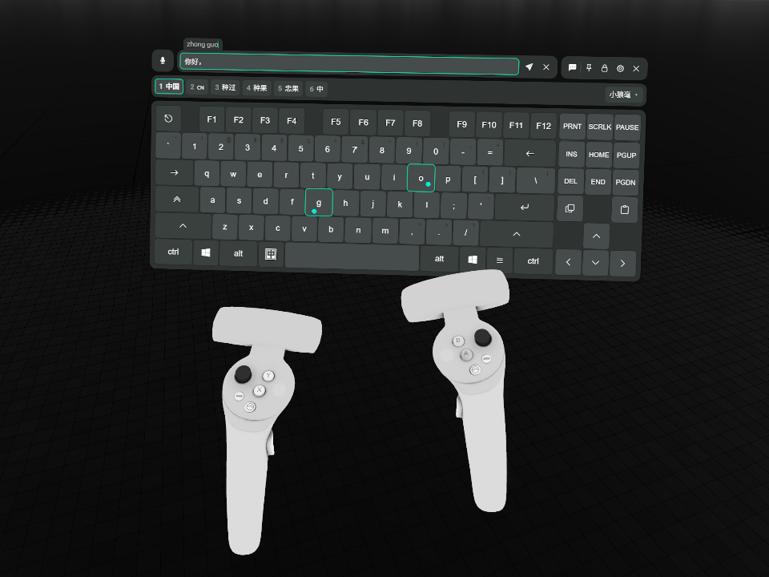
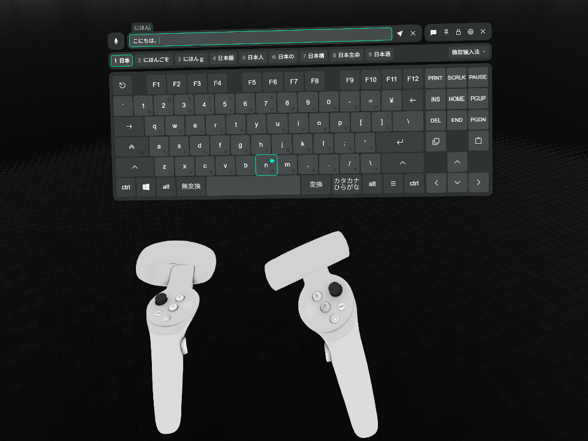

<!-- markdownlint-disable MD033 MD036 -->

# XSOverlay Keyboard IME

[简体中文](README.md) | [繁體中文](README.zh-TW.md) | **日本語** | [한국어](README.ko.md) | [English](README.en.md)

> [!NOTE]
> この文書は LLM が中国語版から翻訳しました。誤訳や、原文と語調が異なる表現が含まれている可能性があります。

XSOverlay の VR キーボードをシステムの IME に接続します。キーボードページの入力欄で未確定の文字列を入力し、その文字列と候補をキーボード上に表示します。候補はキーボードのキーで選び、確定したテキストを入力欄へ書き戻します。

VRC ChatBox の機能も強化します。有効にして入力欄にフォーカスすると、本文を毎秒 1 回、頭上の吹き出しへ反映します。IME の未確定文字列は含みません。入力欄を空にするかフォーカスを外しても、吹き出しは残ります。送信に成功すると入力欄を空にします。文字数制限を超えた場合、全文を入力欄に保持し、吹き出しには短縮したプレビューを表示して、エラーを出します。

## 免責

本プロジェクトは、C# エコシステムに詳しくない開発者が AI を使って作りました。実装は粗く、すっきりしたコードを好む開発者には不親切かもしれません。申し訳ありません。整理する案や PR があれば歓迎します。よろしくお願いします。

## このプラグインを作った理由

VRChat での中国語入力には、試した 2 つの方法がいずれも不十分でした。

- [OVR Input Method Bridge](https://store.steampowered.com/app/3448100/OVR_Input_Method_Bridge/) は Microsoft 拼音と搜狗入力法にしか対応しておらず、どちらも普段あまり使いません。UI も使いにくく、ぎりぎり使える程度でした。
- [Tapi](https://booth.pm/zh-cn/items/7047187) は入力体験こそ非常に優れていますが、Rime をベースにした独自の入力方式を内蔵し、システムの IME とは連携しません。普段から育ててきた辞書の移行も手軽ではありません。

また [OVR Toolkit](https://store.steampowered.com/app/1068820/OVR_Toolkit/) は仮想キーボードを内蔵していますが、パフォーマンスの問題が知られているため検討対象から外しました。中国語入力を扱えるか、コミュニティに既存の方法があるかは、私も検証していません。

ちょうどその頃、XSOverlay のキーボードが公式に VRC ChatBox 機能をサポートしたことに気づきました。そこでシステムの IME を接続し、育てた辞書をそのまま使えるようにする、というアイデアが生まれました。このプラグインはそこから始まっています。

### 開発者より

AI エージェントと最後の難しい不具合を直す中で、システムの IME を汎用的に接続するには、こんなにも多くの奇妙な事情を考慮する必要があるのだと気づきました。初期から妥協を迫られた問題もあれば、終盤に現れた複雑な境界条件もあります。汎用性を保ち、実装を複雑にしすぎないために、使い勝手をいくらか犠牲にせざるを得ませんでした。詳しくは、この README の「設計上のトレードオフ」と本リポジトリの ADR を参照してください。読むのが大変なら、AI に説明してもらってもかまいません。

このプラグインが最高の VR 入力ソリューションだとは言えません。すでに使いやすいものがあるのに、なぜこんな中途半端なものを作ったのかと、自分でも少し疑問に思い始めています。それでも、もう形にはなりました。困っていることを解決できそうで、これらの妥協による不便も受け入れられるなら、ぜひインストールして試してみてください。興味を持っていただけるだけでも、本当にありがたく、大きな支えと励みになります。

## 展示

<table>
  <tr>
    <td width="50%"></td>
    <td width="50%"></td>
  </tr>
  <tr>
    <td align="center">小狼毫</td>
    <td align="center">日本語 Microsoft IME</td>
  </tr>
</table>

## 動作環境

### システム / ソフトウェアのバージョン

- Windows 10 以降、64 ビット。
- XSOverlay Beta 695。ほかのバージョンは未検証です。
- BepInEx 5.4.23.6、x64 版。ほかのバージョンは未検証です。クイックインストールのアーカイブには含まれています。
- このプラグインはキーボードページに侵襲的な変更を加えます。他のプラグインとの互換性は未検証です。

### IME

- TSF を実装した IME のみ対応します。本リポジトリでは小狼毫（Rime Windows 版）、Microsoft 拼音、日本語 Microsoft IME で検証しています。ほとんどの IME はこのプロトコルに対応しているはずなので、不明な場合はプラグインをインストールして試してください。
- IME でインライン入力（inline preedit）を有効にする必要がある場合があります。無効だと候補しか表示されず、入力中のコードは見えません。
  - 検証では小狼毫で必須でした。小狼毫では `weasel.custom.yaml` に `style/inline_preedit: true` を設定します。

## インストール

### A. クイックインストール（プラグインローダーも一緒に入ります）

1. [最新リリース](https://github.com/lgc2333/XSOverlay-Keyboard-IME/releases/latest) から `XSOverlayKeyboardIme-<バージョン>+BepInEx.zip` をダウンロードします。
2. XSOverlay を終了します。
3. Steam ライブラリで XSOverlay を右クリックし、「管理」→「ローカルファイルを閲覧」を選びます。
4. アーカイブの全ファイルをこのフォルダに展開します。上書きを聞かれたら上書きします。
5. XSOverlay を起動すれば使えます。

このアーカイブにはプラグインと BepInEx 5.4.23.6 x64 が入っています。BepInEx を先に入れている場合、手順 4 は同名ファイルを上書きします。`BepInEx.cfg` と各プラグインの設定は変わりません。

### B. 手動インストール（BepInEx を入れている場合）

1. [BepInEx Releases](https://github.com/BepInEx/BepInEx/releases) から BepInEx 5.4.23.6 x64 をダウンロードし、XSOverlay フォルダに展開します。
2. [最新リリース](https://github.com/lgc2333/XSOverlay-Keyboard-IME/releases/latest) から `XSOverlayKeyboardIme-<バージョン>.zip` をダウンロードします。
3. XSOverlay フォルダに展開します。または展開した `BepInEx\plugins\XSOverlayKeyboardIme\` フォルダ全体をコピーします。
4. XSOverlay を起動すれば使えます。

### インストール後

プラグインのファイルは `BepInEx\plugins\XSOverlayKeyboardIme\` にあります。ログは `BepInEx\LogOutput.log` で、本プラグインの行は `[ime]` で始まります。

アンインストールは `BepInEx\plugins\XSOverlayKeyboardIme\` フォルダを削除します。BepInEx 自身のファイル（`BepInEx\` フォルダ、`winhttp.dll`、`doorstop_config.ini`、`.doorstop_version`）は、ほかのプラグインが使っていないときだけ削除します。

## 設計上のトレードオフ

<!-- ユーザーの意外度が高い順 -->

この節の挙動は不具合に見えますが、意図したものです。

### VRC ChatBox ボタンが有効にならない

VRChat より先に XSOverlay を起動すると、この問題が起こることがあります。TUN モードのプロキシも関係している可能性があります。これは XSOverlay 自体の不具合で、このプラグインでは修正していません。VRChat の起動後に XSOverlay を起動してください。XSOverlay を終了してから再起動しても解決します。

ほかの状況については分かりません。同じ問題に遭遇した方が困らないよう、ここに記載しました。

### 候補をクリックできない理由

候補バーは表示専用です。クリックしても反応しません。ページ送りのボタンもページ番号もありません。

#### こう設計した理由

このプラグインは入力方式の名前による個別対応をしません。この選択には次の制限があります。

候補のクリックは、プラグインが代わりにキーを押すことでしか実現できません。しかし同じキーでも IME によって動作が異なります。候補の移動になることも、ページ送りになることも、何も起きないこともあります。だからキーはあなたに任せます。IME がどう解釈するかに従います。

ページ番号も同じです。IME が報告するページ番号は信用できないので、間違った値を出すよりは表示しません。

#### 代わりの操作

候補の選択とページ送りはキーボードで行います。物理キーボードでもキーボードページ上のキーでもかまいません。普段物理キーボードで IME を操作するのと同じように押してください。プラグインはキーを IME に渡すだけで、キーの意味は IME が決めます。キー割り当てはお使いの IME の設定に従います。キーボードページにないキーは押せないので、あるキーの中から選んでください。

私が使っている rime-frost（白霜拼音）の既定キーを例に挙げます：

- 数字キー、スペース：候補を選ぶ；`-`、`=`：ページ送り
- `↑`、`↓`：候補を移動；`←`、`→`：未確定文字列内でカーソルを移動；`[`、`]`：詞単位で選ぶ；など……

### キーの結果は IME とシステムの応答にそのまま従い、物理キーボードとほぼ同じになる

プラグインは通常のキーをシステムと入力方式へ渡し、結果はそれらが決めます。

組字中に入力方式を切り替えたとき、コードの破棄や元のコードの確定は入力方式が決めます。プラグインは追加のキーを送りません。名前とアイコンは通知や次のキーで更新するため、次の入力まで表示が変わらない場合があります。

Shift、Ctrl、Alt の押下と解放はすぐに Windows へ届きます。粘着、保持、解除の規則は XSOverlay に従います。キーボードを閉じるとこれらのキーを解放し、Caps Lock の状態は保持します。

キーボードページの Win は Win+Space だけに使います。単独ではスタートメニューを開かず、ほかの Win 組み合わせも実行しません。VR での入力中にデスクトップのウィンドウを誤って開くのを防ぎます。

代償として、入力方式自身の不具合もそのままキーボードに現れます。小狼毫（Weasel）を例にします。組字中に中英切り替えキーを押すと（Shift ではなく、システムの言語バーのアイコンをクリックするのと同じ操作）、組字は終わらないまま候補だけが消え、中国語モードに戻すとまた組字を続けられます。一方、Microsoft 拼音は切り替えると元のコードをそのまま確定します。非常に戸惑う挙動ですが、それは入力方式側の話で、プラグインが後始末をするものではありません。

### 入力方式と入力モードの切り替え

バーの右側に入力方式の名前とドロップダウンを表示します。中英切り替えキーは左 Alt の右隣に表示します。表示中はスペースキーの幅を狭め、非表示にすると元に戻します。キー列の幅は変わりません。

ドロップダウンには、すべての言語で有効になっている IME と通常のキーボード配列が並びます。項目の選択、または Win+Space で切り替えます。Windows の入力方式の共有設定により、デスクトップのウィンドウも一緒に切り替わる場合があります。現在の入力方式を取得できない場合は、薄暗い「未知输入法」と表示し、古いアイコンと選択マークを消します。一覧を取得できていれば、ドロップダウンから選択できます。

入力モード切り替えボタンは、入力方式の言語バーにある追加アイコンを 1 回クリックする操作を再現します。最終的な動作は各入力方式が決めるため、予期しない動作が起きる場合があります。たとえば、小狼毫は切り替えても組字を終了しません。物理キーボードでの実測でも同じ問題が起きたため、プラグインの対応範囲外です。

Microsoft 拼音と日本語 Microsoft IME は元のモード字形を表示します。ボタンをクリックするか、キーボードで入力方式の切り替えショートカットを使うと入力モードを切り替えられます（たとえば Shift を素早く 3 回タップします。最初の 2 回で押下の保持を有効にし、3 回目で解放することで、物理キーボードでの 1 回の Shift の押下と解放を再現します）。一部の古いシステムでは互換性の問題が生じる場合があります。過去の互換性テストは[アーカイブ](docs/archived/notes/input-mode-shell.md#支持范围)を参照してください。

### 入力欄がフォーカスを持たない間、入力方式の名前と中英切り替えキーが隠れる理由

入力欄がフォーカスを失うと、入力方式の情報には安定した出どころがなくなります。常に正しい値を取れないため、表示した内容はいつ実際と食い違ってもおかしくありません。当てにならない名前を出すより、隠したほうがましです。

名前は「次のキーを受け取る入力方式」を示し、入力欄にフォーカスがある間だけ表示します。中英切り替えキーは言語バーに追加のモードアイコンがある場合に表示します。元の画像を取得できない場合は固定表示を使い、US 配列では隠します。

### キーボードページの入力欄でしか効かない理由

組字には前面への移動とキーの代行が必要で、範囲を広げるとほかのウィンドウにも及びます。リスクが利点を上回るので、プラグインが奪うのはキーボードページ備え付けの入力欄のキーだけです。XSOverlay 内のほかの入力欄、デスクトップ、ほかのアプリは対象外で、今後も対応しません。

### 組字中に一時的に前面を奪う理由

組字ではキーを IME に渡す必要があり、その方法はグローバルなキー入力の模擬しかありません。模擬したキーは前面のウィンドウにしか届きません。

キーを送る前に、プラグインは隠しウィンドウを前面に出す操作を一度試し、終了後に前面を返します。失敗したキーは送らず、失敗を記録します。再試行はしません。

### 候補バーが空でも残る理由

候補がないときもバーは消えません。キーボードウィンドウの高さが変わらないので、入力中にキーボードが上下しません。

組字は入力のたびに始まり、終わります。バーが内容に合わせて出たり消えたりすると、そのたびに高さが変わり、VR では負担になります。

### 組字中に送信キーが灰色になる理由

組字中の文字列は一時的に入力欄に入ります。キーボードページは入力欄が空でないと送信キーを押せるようにするので、断りもなくピンインが送られてしまいます。そこでプラグインは組字中は送信キーを押せない状態へ戻します。確定または取り消しで元に戻ります。

## ビルド

.NET SDK 10 以降、CMake、Visual Studio の C++ ビルドツールが必要です。

先に上流のソースを取得し、ネイティブライブラリをビルドします：

```powershell
git submodule update --init
pwsh native/build.ps1
```

次にプラグインをビルドします：

```powershell
dotnet build -c Release
```

プラグインとネイティブライブラリを XSOverlay に入れます：

```powershell
dotnet build -c Release -p:DeployToGame=true
```

リポジトリで設定済みの XSOverlay のパスは `D:\SteamLibrary\steamapps\common\XSOverlay_Beta` です。XSOverlay が別の場所にある場合は、`GameDir` プロパティでパスを指定します：

```powershell
dotnet build -c Release -p:DeployToGame=true -p:GameDir="D:\Steam\steamapps\common\XSOverlay_Beta"
```

配布用のアーカイブをビルドします：

```powershell
pwsh scripts/pack.ps1
```

`dist/XSOverlayKeyboardIme-<バージョン>.zip`（プラグインのみ）と `dist/XSOverlayKeyboardIme-<バージョン>+BepInEx.zip`（プラグインと BepInEx）を書き出します。スクリプトはリポジトリの `GameDir` を使います。別のフォルダでビルドするには `-GameDir` を渡します。

## 謝辞

- [Windmill-City/IngameIME-Common](https://github.com/Windmill-City/IngameIME-Common)、[Windmill-City/IngameIME_Win32](https://github.com/Windmill-City/IngameIME_Win32)：TSF の入力コンテキストとコンポジションのコールバック。この依存は本リポジトリの C シムと一緒に `IngameIME.dll` へ組み込まれ、全体を LGPL 2.1 で配布します。[THIRD-PARTY-NOTICES.md](THIRD-PARTY-NOTICES.md) を参照してください。
- DeepSeek V4.1 Flash & DeepSeek Harness、GPT 6.1 Sol & Codex：本プロジェクト全体をぽっちゃりクジラママと小さなドラゴン娘が構築しました。

## スポンサー

**[スポンサーになる](https://lgck.cc/sponsor)**

支援してくださる皆様に感謝します！皆様の支援が、創作を続ける力になります！

## 連絡先

- QQ：3076823485
- QQ グループ：[168603371](https://qm.qq.com/q/EikuZ5sP4G)
- Telegram：[@lgc2333](https://t.me/lgc2333)
- メール：<lgc2333@126.com>

## ライセンス

プラグインのコードは MIT ライセンスで配布します。全文は [LICENSE](LICENSE) にあります。

プラグインは `IngameIME.dll` を同梱します。これには IngameIME と `native/shim/` の C レイヤーが含まれ、ファイル全体を GNU LGPL 2.1 で配布します。全文は [native/LICENSE-LGPL-2.1.txt](native/LICENSE-LGPL-2.1.txt) にあります。`IngameIME.dll` はプラグインの隣にある独立したファイルなので、ビルドし直して差し替えられます。方法は [THIRD-PARTY-NOTICES.md](THIRD-PARTY-NOTICES.md) を参照してください。

---

_Made with ♥️ by LgCuwukii_
