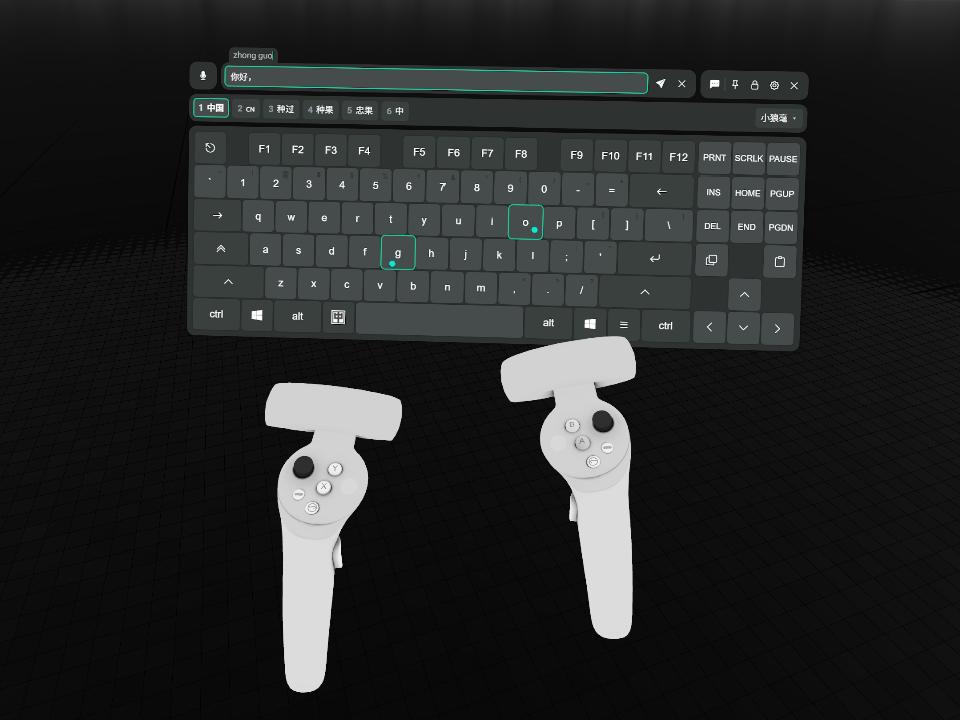
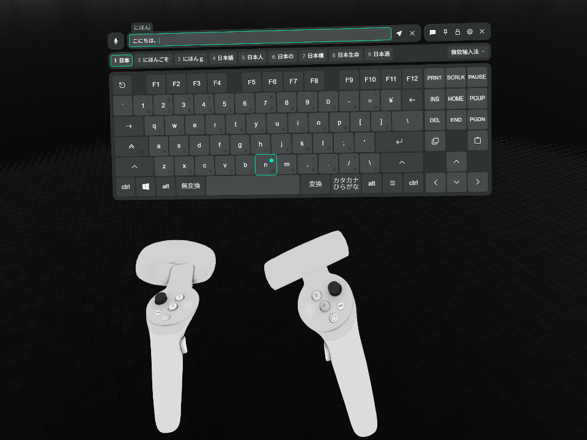

<!-- markdownlint-disable MD033 MD036 -->

# XSOverlay Keyboard IME

[简体中文](README.md) | [繁體中文](README.zh-TW.md) | [日本語](README.ja.md) | **한국어** | [English](README.en.md)

> [!NOTE]
> 이 문서는 LLM이 중국어판을 번역한 것입니다. 오역이 있거나 원문과 어조가 다를 수 있습니다.

XSOverlay의 VR 키보드를 시스템 IME에 연결합니다. 키보드 페이지의 입력란에서 조합 중인 문자열을 입력하고, 그 문자열과 후보를 키보드 위에 표시합니다. 후보는 키보드의 키로 고르고, 확정한 텍스트를 입력란에 다시 써 넣습니다.

VRC ChatBox 기능도 개선합니다. 이 기능을 켜고 입력란에 포커스를 두면 본문이 1초에 한 번 머리 위 말풍선에 반영됩니다. IME 조합 중인 문자열은 포함하지 않습니다. 입력란을 비우거나 포커스를 옮겨도 말풍선은 유지됩니다. 전송에 성공하면 입력란을 비웁니다. 글자 수를 초과하면 입력란에 전체 내용을 유지하고, 말풍선에는 줄인 미리보기를 표시하며 오류를 알립니다.

## 고지

이 프로젝트는 C# 생태계를 잘 모르는 개발자가 AI를 써서 처음부터 끝까지 만들었습니다. 코드가 거칠고, 깔끔한 코드를 중시하는 개발자에게는 불편할 수 있습니다. 죄송합니다. 정리할 방법이나 PR이 있다면 환영합니다. 감사합니다.

## 이 플러그인을 만든 이유

VRChat에서의 중국어 입력에는, 시도한 두 가지 방법이 모두 충분하지 않았습니다.

- [OVR Input Method Bridge](https://store.steampowered.com/app/3448100/OVR_Input_Method_Bridge/)는 Microsoft 병음과 搜狗 입력기만 지원하는데, 둘 다 평소에 잘 쓰지 않습니다. UI도 너무 불편해서 겨우 쓸 만한 수준이었습니다.
- [Tapi](https://booth.pm/zh-cn/items/7047187)는 입력 경험이 매우 좋지만, Rime 기반의 자체 입력 방식을 내장하고 있어 시스템 IME와 연동되지 않습니다. 평소에 키워 온 사전을 옮기는 것도 번거롭습니다.

또한 [OVR Toolkit](https://store.steampowered.com/app/1068820/OVR_Toolkit/)은 가상 키보드를 내장하고 있지만, 성능 문제가 알려져 있어 검토 대상에서 제외했습니다. 중국어 입력을 지원하는지, 커뮤니티에 기존 방법이 있는지는 저도 검증하지 않았습니다.

마침 XSOverlay 키보드가 최근 VRC ChatBox 기능을 공식 지원한다는 것을 알게 되었습니다. 그래서 시스템 IME를 연결해 키워 온 사전을 그대로 쓰자는 생각이 들었고, 이 플러그인이 여기서 시작되었습니다.

### 개발자 메모

AI 에이전트와 마지막 몇 가지 어려운 버그를 고치면서, 시스템 IME를 범용으로 연결하려면 이렇게 많은 특이한 문제를 고려해야 한다는 것을 깨달았습니다. 프로젝트 초반부터 타협이 필요했던 문제도 있었고, 막바지에 나타난 복잡한 경계 상황도 있었습니다. 범용성을 유지하고 구현의 복잡도를 줄이려면 사용 편의성을 어느 정도 희생할 수밖에 없었습니다. 자세한 내용은 이 README의 설계상의 절충 절과 저장소의 ADR을 참고하십시오. 읽기 번거로우면 AI에게 설명을 요청해도 됩니다.

이 플러그인이 최고의 VR 입력 솔루션이라고는 말할 수 없습니다. 이미 쓰기 좋은 도구가 있는데 왜 이런 어중간한 것을 만들었는지 저도 조금 의문이 들기 시작했습니다. 그래도 이미 만들었으니, 겪고 있는 불편을 해결할 수 있을 것 같고 이런 타협에 따른 불편도 받아들일 수 있다면 설치해서 써 보십시오. 이 플러그인에 관심을 가져 주시는 것만으로도 정말 감사하며, 큰 지지와 격려가 됩니다.

## 쇼케이스

<table>
  <tr>
    <td width="50%"></td>
    <td width="50%"></td>
  </tr>
  <tr>
    <td align="center">小狼毫</td>
    <td align="center">일본어 Microsoft IME</td>
  </tr>
</table>

## 실행 요구 사항

### 시스템 / 소프트웨어 버전

- Windows 10 이상, 64비트.
- XSOverlay Beta 695. 다른 버전은 검증하지 않았습니다.
- BepInEx 5.4.23.6, x64 버전. 다른 버전은 검증하지 않았습니다. 빠른 설치 압축 파일에는 포함되어 있습니다.
- 이 플러그인은 키보드 페이지에 침습적인 변경을 적용합니다. 다른 플러그인과의 호환성은 검증하지 않았습니다.

### IME

- TSF를 구현한 IME만 지원합니다. 이 저장소는 小狼毫(Rime Windows 버전), Microsoft 병음, 일본어 Microsoft IME로 검증했습니다. 대부분의 IME는 이 프로토콜을 지원할 것으로 예상하므로, 확실하지 않으면 플러그인을 설치해서 직접 시험해 보십시오.
- IME에서 인라인 프리 에디트(inline preedit)를 켜야 할 수도 있습니다. 끄면 후보만 보이고 입력 중인 코드는 보이지 않습니다.
  - 검증해 보니 小狼毫에서는 필수였습니다. 小狼毫에서는 `weasel.custom.yaml`에 `style/inline_preedit: true`를 설정합니다.

## 설치

### A. 빠른 설치 (플러그인 로더까지 함께 설치)

1. [최신 릴리스](https://github.com/lgc2333/XSOverlay-Keyboard-IME/releases/latest)에서 `XSOverlayKeyboardIme-<버전>+BepInEx.zip`을 받습니다.
2. XSOverlay를 종료합니다.
3. Steam 라이브러리에서 XSOverlay를 마우스 오른쪽 버튼으로 누르고 관리 > 로컬 파일 보기를 선택합니다.
4. 압축 파일의 모든 파일을 이 폴더에 풉니다. 덮어쓸지 물으면 덮어씁니다.
5. XSOverlay를 시작하면 바로 쓸 수 있습니다.

이 압축 파일에는 플러그인과 BepInEx 5.4.23.6 x64가 들어 있습니다. BepInEx를 먼저 설치했다면 4단계는 같은 이름의 파일을 덮어씁니다. `BepInEx.cfg`와 각 플러그인의 설정은 그대로입니다.

### B. 수동 설치 (BepInEx를 설치한 경우)

1. [BepInEx Releases](https://github.com/BepInEx/BepInEx/releases)에서 BepInEx 5.4.23.6 x64를 받아 XSOverlay 폴더에 풉니다.
2. [최신 릴리스](https://github.com/lgc2333/XSOverlay-Keyboard-IME/releases/latest)에서 `XSOverlayKeyboardIme-<버전>.zip`을 받습니다.
3. XSOverlay 폴더에 풉니다. 또는 푼 `BepInEx\plugins\XSOverlayKeyboardIme\` 폴더 전체를 복사합니다.
4. XSOverlay를 시작하면 바로 쓸 수 있습니다.

### 설치 후

플러그인 파일은 `BepInEx\plugins\XSOverlayKeyboardIme\`에 있습니다. 로그는 `BepInEx\LogOutput.log`이고, 이 플러그인의 줄은 `[ime]`로 시작합니다.

삭제하려면 `BepInEx\plugins\XSOverlayKeyboardIme\` 폴더를 지웁니다. BepInEx 자체 파일(`BepInEx\` 폴더, `winhttp.dll`, `doorstop_config.ini`, `.doorstop_version`)은 다른 플러그인이 쓰지 않을 때만 지웁니다.

## 설계상의 절충

<!-- 사용자가 놀랄 만한 순서대로 -->

이 절의 동작은 오류처럼 보이지만 의도된 것입니다.

### VRC ChatBox 버튼이 활성화되지 않는 경우

VRChat보다 먼저 XSOverlay를 실행하면 이런 문제가 발생할 수 있습니다. TUN 모드 프록시도 관련이 있을 수 있습니다. 이는 XSOverlay 자체의 결함이며, 이 플러그인에서는 수정하지 않았습니다. VRChat을 실행한 다음 XSOverlay를 실행하십시오. XSOverlay를 종료한 뒤 다시 실행해도 해결됩니다.

다른 상황에 대해서는 잘 모르겠습니다. 같은 문제를 겪는 분들이 계속 혼란스러워하지 않도록 여기에 적었습니다.

### 후보를 클릭할 수 없는 이유

후보 표시줄은 보기 전용입니다. 클릭해도 반응이 없고, 페이지 넘김 버튼도 페이지 번호도 없습니다.

#### 이렇게 설계한 이유

이 플러그인은 입력기 이름에 따라 별도로 처리하지 않습니다. 이 선택에는 다음 제한이 있습니다.

후보 클릭은 플러그인이 대신 키를 눌러야만 됩니다. 그런데 같은 키라도 IME마다 동작이 다릅니다. 후보 이동이 되기도, 페이지 넘김이 되기도, 아무 일도 없기도 합니다. 그래서 키는 직접 누르시게 합니다. IME가 해석하는 대로 따릅니다.

페이지 번호도 마찬가지입니다. IME가 알려 주는 페이지 번호는 믿을 수 없어서, 틀린 값을 보여 주느니 표시하지 않습니다.

#### 대신 이렇게 하세요

후보 선택과 페이지 넘김은 키보드로 합니다. 물리 키보드든 키보드 페이지의 키든 괜찮습니다. 평소 물리 키보드에서 IME를 쓰던 방식대로 누르세요. 플러그인은 키를 IME에 넘기기만 하고, 키의 의미는 IME가 정합니다. 키 배치는 쓰시는 IME 설정을 따릅니다. 키보드 페이지에 없는 키는 누를 수 없으니 있는 키 중에서 고르세요.

제가 쓰는 rime-frost(白霜拼音)의 기본 키를 예로 듭니다.

- 숫자 키, 스페이스: 후보 선택; `-`, `=`: 페이지 넘김
- `↑`, `↓`: 후보 이동; `←`, `→`: 조합 중인 문자열 안에서 커서 이동; `[`, `]`: 단어 단위 선택; 등등……

### 키 결과는 입력기와 시스템의 응답을 그대로 따르며, 물리 키보드와 거의 같습니다

플러그인은 일반 키를 시스템과 입력기로 전달하고, 결과는 시스템과 입력기가 결정합니다.

조합 중에 입력기를 바꾸면 코드 폐기나 원래 코드 확정은 입력기가 결정합니다. 플러그인은 키를 추가로 보내지 않습니다. 이름과 아이콘은 알림이나 다음 키 입력으로 갱신하므로 다음 입력까지 표시가 바뀌지 않을 수 있습니다.

Shift, Ctrl, Alt의 누름과 해제는 즉시 Windows로 전달합니다. 고정, 유지, 해제 규칙은 XSOverlay를 따릅니다. 키보드를 닫으면 이 키들을 해제하고 Caps Lock 상태는 유지합니다.

키보드 페이지의 Win은 Win+Space에만 씁니다. 단독으로 눌러도 시작 메뉴를 열지 않으며, 다른 Win 조합도 실행하지 않습니다. VR 입력 중에 바탕 화면 창이 실수로 열리는 것을 방지합니다.

그 대가로 입력기 자체의 문제도 그대로 키보드에 나타납니다. 小狼毫(Weasel)를 예로 듭니다. 조합 중에 中/英 전환 키를 누르면(Shift가 아니라 시스템 언어 표시줄 아이콘을 클릭하는 것과 같습니다) 조합은 끝나지 않은 채 후보만 사라지고, 중국어 모드로 돌아오면 다시 조합을 이어 갈 수 있습니다. 반면 Microsoft 拼音은 전환하면 원래 코드를 그대로 확정합니다. 매우 혼란스러운 동작이지만 그건 입력기 쪽 일이며, 플러그인이 뒤처리를 하지 않습니다.

### 입력기와 입력 모드 전환

표시줄 오른쪽에 입력기 이름과 드롭다운이 나옵니다. 中/英 전환 키는 왼쪽 Alt 오른쪽에 표시됩니다. 전환 키가 보이면 스페이스 키가 좁아지고, 숨기면 원래 폭으로 돌아갑니다. 키 줄의 폭은 바뀌지 않습니다.

드롭다운에는 모든 언어에서 활성화한 입력기와 일반 키보드 배열이 나옵니다. 항목을 선택하거나 Win+Space로 전환합니다. Windows의 입력기 공유 설정에 따라 데스크톱 창의 입력기도 함께 바뀔 수 있습니다. 현재 입력기를 읽을 수 없으면 어두운 “未知输入法” 표시를 쓰고 이전 아이콘과 선택 표시를 지웁니다. 목록을 읽을 수 있으면 드롭다운에서 계속 선택할 수 있습니다.

입력 모드 전환 버튼은 입력기 언어 표시줄의 추가 아이콘을 한 번 클릭하는 동작을 재현합니다. 최종 동작은 각 입력기가 결정하므로 예상하지 못한 동작이 생길 수 있습니다. 예를 들어 小狼毫(Weasel)는 전환 후에도 조합을 끝내지 않습니다. 실제 키보드로 테스트해도 같은 문제가 발생하므로 플러그인의 대응 범위에 포함하지 않습니다.

Microsoft 拼音과 일본어 Microsoft IME는 원래 모드 글리프를 표시합니다. 버튼을 클릭하거나 키보드에서 입력기의 전환 단축키를 사용하면 입력 모드를 바꿀 수 있습니다(예를 들어 Shift를 빠르게 세 번 누릅니다. 두 번 눌러 누른 상태를 유지한 뒤 세 번째에 해제하여 실제 키보드에서 Shift를 한 번 눌렀다 떼는 동작을 재현합니다). 일부 구형 시스템에서는 호환성 문제가 발생할 수 있습니다. 이전 호환성 테스트는 [보관 기록](docs/archived/notes/input-mode-shell.md#支持范围)을 참조하십시오.

### 입력란에 포커스가 없을 때 입력기 이름과 中/英 전환 키가 숨는 이유

입력란이 포커스를 잃으면 입력기 정보에는 안정적인 출처가 없어집니다. 항상 맞는 값을 얻을 수 없어서, 표시한 내용이 언제 실제와 어긋나도 이상하지 않습니다. 믿을 수 없는 이름을 보여 주느니 숨기는 편이 낫습니다.

이름은 다음 키를 받을 입력기를 뜻하며, 입력란에 포커스가 있을 때 표시합니다. 中/英 전환 키는 언어 표시줄에 추가 모드 아이콘이 있을 때 표시합니다. 원본 이미지를 읽지 못하면 고정 표시를 쓰고, US 배열에서는 숨깁니다.

### 키보드 페이지의 입력란에서만 동작하는 이유

조합하려면 창을 앞으로 가져오고 키를 대신 눌러야 합니다. 범위를 넓히면 다른 창까지 건드리게 되어 이득보다 위험이 큽니다. 그래서 플러그인은 키보드 페이지에 붙은 입력란의 키만 가져옵니다. XSOverlay 안의 다른 입력란, 바탕 화면, 다른 앱은 대상이 아니며 앞으로도 지원하지 않습니다.

### 조합 중에 잠깐 앞으로 나오는 이유

조합하려면 키를 IME로 보내야 하는데, 그 방법은 전역 키 입력을 흉내 내는 것뿐입니다. 흉내 낸 키는 앞에 있는 창에만 도착합니다.

키를 보내기 전에 플러그인은 숨은 창을 앞으로 가져오는 작업을 한 번 시도하고, 끝나면 돌려줍니다. 실패하면 해당 키를 보내지 않고 실패를 기록합니다. 다시 시도하지 않습니다.

### 후보 표시줄이 비어 있어도 남는 이유

후보가 없을 때도 표시줄은 사라지지 않습니다. 키보드 창의 높이가 변하지 않으므로 입력하는 동안 키보드가 위아래로 움직이지 않습니다.

조합은 입력할 때마다 시작되고 끝납니다. 표시줄이 내용에 따라 나타났다 사라지면 그때마다 높이가 바뀌어 VR에서 불편합니다.

### 조합 중에 보내기 키가 회색이 되는 이유

조합 중인 문자열이 잠시 입력란에 들어갑니다. 키보드 페이지는 입력란이 비어 있지 않으면 보내기 키를 누를 수 있게 해 두어서, 말리지도 않고 병음이 전송될 수 있습니다. 그래서 플러그인은 조합 중에 보내기 키를 다시 누를 수 없는 상태로 돌려놓습니다. 확정하거나 취소하면 원래대로 돌아옵니다.

## 빌드

.NET SDK 10 이상, CMake, Visual Studio의 C++ 빌드 도구가 필요합니다.

먼저 업스트림 소스를 받고 네이티브 라이브러리를 빌드합니다.

```powershell
git submodule update --init
pwsh native/build.ps1
```

그다음 플러그인을 빌드합니다.

```powershell
dotnet build -c Release
```

플러그인과 네이티브 라이브러리를 XSOverlay에 함께 넣습니다.

```powershell
dotnet build -c Release -p:DeployToGame=true
```

저장소에 설정된 XSOverlay 경로는 `D:\SteamLibrary\steamapps\common\XSOverlay_Beta`입니다. XSOverlay가 다른 곳에 있으면 `GameDir` 속성으로 경로를 지정합니다.

```powershell
dotnet build -c Release -p:DeployToGame=true -p:GameDir="D:\Steam\steamapps\common\XSOverlay_Beta"
```

배포용 압축 파일을 만듭니다.

```powershell
pwsh scripts/pack.ps1
```

`dist/XSOverlayKeyboardIme-<버전>.zip`(플러그인만)과 `dist/XSOverlayKeyboardIme-<버전>+BepInEx.zip`(플러그인과 BepInEx)을 씁니다. 스크립트는 저장소의 `GameDir`을 씁니다. 다른 폴더에서 빌드하려면 `-GameDir`를 넘깁니다.

## 감사의 말

- [Windmill-City/IngameIME-Common](https://github.com/Windmill-City/IngameIME-Common), [Windmill-City/IngameIME_Win32](https://github.com/Windmill-City/IngameIME_Win32): TSF 입력 컨텍스트와 조합 콜백. 이 의존성은 이 저장소의 C 심과 함께 `IngameIME.dll`로 빌드되며, 전체를 LGPL 2.1로 배포합니다. [THIRD-PARTY-NOTICES.md](THIRD-PARTY-NOTICES.md)를 참고하세요.
- DeepSeek V4.1 Flash & DeepSeek Harness, GPT 6.1 Sol & Codex: 이 프로젝트 전체를 통통한 고래 엄마와 꼬마 드래곤 소녀가 만들었습니다.

## 후원

**[후원하기](https://lgck.cc/sponsor)**

후원해 주시는 모든 분께 감사드립니다! 여러분의 후원이 계속 만들 힘이 됩니다!

## 연락처

- QQ: 3076823485
- QQ 그룹: [168603371](https://qm.qq.com/q/EikuZ5sP4G)
- Telegram: [@lgc2333](https://t.me/lgc2333)
- 이메일: <lgc2333@126.com>

## 라이선스

플러그인 코드는 MIT 라이선스로 배포합니다. 전문은 [LICENSE](LICENSE)에 있습니다.

플러그인은 `IngameIME.dll`을 함께 배포합니다. 이 파일에는 IngameIME과 `native/shim/`의 C 레이어가 들어 있고, 파일 전체를 GNU LGPL 2.1로 배포합니다. 전문은 [native/LICENSE-LGPL-2.1.txt](native/LICENSE-LGPL-2.1.txt)에 있습니다. `IngameIME.dll`은 플러그인 옆에 있는 별도 파일이므로 다시 빌드해 바꿔 넣을 수 있습니다. 방법은 [THIRD-PARTY-NOTICES.md](THIRD-PARTY-NOTICES.md)를 보십시오.

---

_Made with ♥️ by LgCuwukii_
