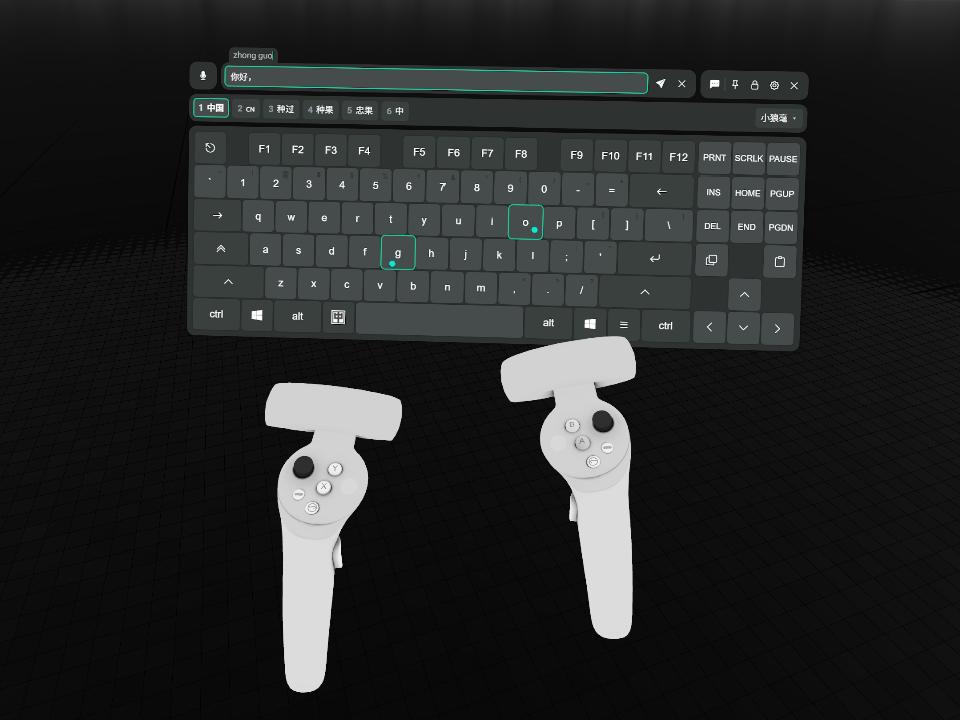
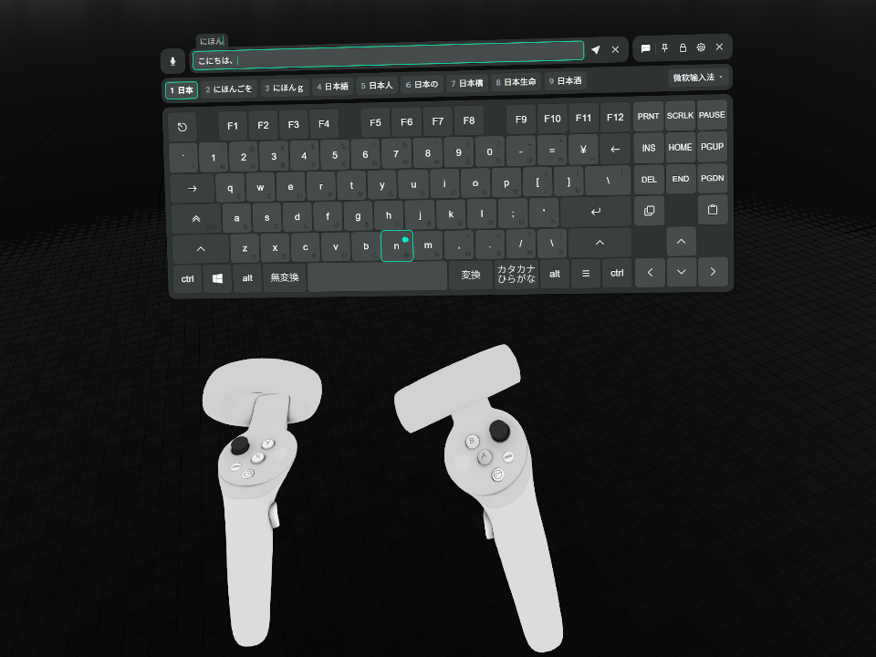

<!-- markdownlint-disable MD033 MD036 -->

# XSOverlay Keyboard IME

**简体中文** | [繁體中文](README.zh-TW.md) | [日本語](README.ja.md) | [한국어](README.ko.md) | [English](README.en.md)

给 XSOverlay 的 VR 键盘接入系统输入法：在键盘页的输入框里组字，组字串与候选显示在键盘上，用键盘上的按键选候选，提交后写回输入框。

以及 VRC ChatBox 功能增强：开启它并聚焦输入框后，正文每秒更新一次头顶气泡（不包括预编辑），清空或失焦保留气泡，发送成功后清空输入框。正文超限时保留本地全文，气泡显示截短预览并报错。

## 声明

本项目由一个不了解 C# 生态的开发者全程使用 AI 构建。代码实现可能会有些脏，可能对洁癖开发者非常不友好，在这里我说一声抱歉。如果你有清理代码中这类问题的想法的话，也欢迎提出方案或 PR，感谢。

## 为什么做这个插件

VRChat 里的中文输入，试过的两个方案都不够用。

- [OVR Input Method Bridge](https://store.steampowered.com/app/3448100/OVR_Input_Method_Bridge/)：只支持微软拼音和搜狗输入法，两个我都不常用；界面也太不顺手。所以只算勉强凑合能用。
- [Tapi](https://booth.pm/zh-cn/items/7047187)：虽然输入体验确实非常好，但是它是自带的一套基于 Rime 的输入方案，不和系统输入法打通，按习惯养出来的词库要带过去也不太方便。

另有 [OVR Toolkit](https://store.steampowered.com/app/1068820/OVR_Toolkit/)，自带虚拟键盘，但已知有性能问题，因此未纳入考虑；它能否输入中文、社区有无现成方案，我未实测。

正巧我发现 XSOverlay 的键盘近期官方支持了 VRC ChatBox 功能。所以我有了这个想法：把它接上系统输入法，养好的词库就能直接用。这个插件由此开始。

### 开发者注

在和 AI Agent 修最后几个疑难 Bug 的时候我才意识到，做出一个依赖公用 API 接入系统输入法的通用方案原来要考虑这么多奇奇怪怪的事情——不管是项目初期就冒出来需要向它妥协的问题（比如候选与翻页），还是最后出现的一系列复杂竞态与边界情况……没办法，为了通用性与工程实现上的复杂度，只能牺牲用户体验来换取它们了：具体可以看 README 下的设计取舍一节，以及本仓库的 ADR（懒得看可以让 AI 给你讲）。

我不敢说本插件是最好的 VR 输入法解决方案，我也有些开始怀疑，明明已经有很好用的东西了，我为什么还要做这么个不伦不类的东西。但既然做都做出来了，如果它看起来能解决你的痛点，你也能接受因这些妥协而带来的不便，不妨装上试试看。如果你对这个插件感兴趣，我会非常感谢你，你的喜欢是对我莫大的支持和鼓励。

## 展示

<table>
  <tr>
    <td width="50%"></td>
    <td width="50%"></td>
  </tr>
  <tr>
    <td align="center">小狼毫</td>
    <td align="center">微软日语</td>
  </tr>
</table>

## 运行要求

### 系统 / 软件版本

- Windows 10 或更高版本，64 位。
- XSOverlay Beta 695，其他版本未经验证。
- BepInEx 5.4.23.6，x64 版本，其他版本未经验证。（快速安装的压缩包已包含它）
- 本插件对键盘页做了一些侵入性修改，与其他插件的兼容性未经验证。

### 输入法

- 仅支持实现了 TSF 的输入法。本仓库使用小狼毫（Rime Windows 版）、微软拼音与微软日语输入法验证。（大部分输入法理应都支持这个协议，如果不确定可以装上插件亲自试试）
- 输入法可能需要开启行内预编辑，否则只能看到候选，看不到正在输入的编码。
  - 实测小狼毫必需，其须在 `weasel.custom.yaml` 中设置 `style/inline_preedit: true`。

## 安装

### A. 快速安装（直接连带插件加载器一同安装）

1. 从 [最新 Release](https://github.com/lgc2333/XSOverlay-Keyboard-IME/releases/latest) 下载 `XSOverlayKeyboardIme-<版本>+BepInEx.zip`。
2. 退出 XSOverlay。
3. 在 Steam 库中右键 XSOverlay，选择「管理」→「浏览本地文件」。
4. 把压缩包里的全部文件解压进这个文件夹，询问覆盖时选择覆盖。
5. 启动 XSOverlay 即可开始使用。

这个压缩包里是插件加 BepInEx 5.4.23.6 x64。之前装过 BepInEx 的话，第 4 步会覆盖它的同名文件，`BepInEx.cfg` 与各插件的配置不受影响。

### B. 手动安装（如果你安装过 BepInEx）

1. 从 [BepInEx Releases](https://github.com/BepInEx/BepInEx/releases) 下载 BepInEx 5.4.23.6 x64，解压进 XSOverlay 文件夹。
2. 从 [最新 Release](https://github.com/lgc2333/XSOverlay-Keyboard-IME/releases/latest) 下载 `XSOverlayKeyboardIme-<版本>.zip`。
3. 把它解压进 XSOverlay 文件夹，或解压后把 `BepInEx\plugins\XSOverlayKeyboardIme\` 整个复制过去。
4. 启动 XSOverlay 即可开始使用。

### 装好之后

插件文件在 `BepInEx\plugins\XSOverlayKeyboardIme\`。日志在 `BepInEx\LogOutput.log`，本插件写入的行以 `[ime]` 开头。

要卸载，删除 `BepInEx\plugins\XSOverlayKeyboardIme\` 文件夹。BepInEx 自己的文件（`BepInEx\` 文件夹、`winhttp.dll`、`doorstop_config.ini`、`.doorstop_version`）只有在没有其他插件使用它们时才删除。

## 设计取舍

<!-- 按用户意外程度从高到低排序 -->

本节的行为看起来像故障，其实是有意为之。

### VRC ChatBox 按钮点不亮

如果你在 VRChat 启动之前启动了 XSOverlay，且你可能也挂着 TUN 模式的代理，那这是 XSOverlay 自身的缺陷。本插件没去修复它，而且解决方案很简单：在 VRChat 启动之后再启动 XSOverlay 就能解决；关掉再重启 XSOverlay 也行。

其他情况就不太清楚了。只是感觉可能会有和我遇到一样问题的朋友，为了防止他们一直困惑，索性就写在这里了。

### 候选为什么点不了

候选栏只能看，点它不会有反应，也没有翻页按钮和页码。

#### 设计考量

本插件不按输入法名称做单独适配。这个取舍的弊端就体现在此。

点选候选要插件替你按键，但同一串键在不同输入法里的行为并不一样：可能换候选，可能翻页，也可能毫无反应。所以按键交回给你，输入法怎么解释就怎么执行。

页码同理，输入法报告的页码不可靠，宁可不显示也不显示错的。

#### 替代方案

选候选、翻页都请按键盘，物理键盘和键盘页上的按键都可以，按你平时在物理键盘上用输入法的习惯操作。插件只负责把按键转交给输入法，按键是什么意思由输入法自己决定。键位以你自己的输入法配置为准；键盘页上没有的键按不了，请挑键盘上有的键用。

以我正在使用的 rime-frost（白霜拼音）方案的默认键位为例：

- 数字键、空格：选候选；`-`、`=`：翻页
- `↑`、`↓`：换候选；`←`、`→`：移动组字串里的光标；`[`、`]`：以词定字；等等……

### 按键结果诚实遵守输入法和系统响应，和使用物理键盘尽量一致

插件把普通按键交给系统以及输入法，结果由它们决定。

组字中换输入法，丢弃编码或提交原始码都由输入法决定，插件不补按键。名字与图标随通知或后续按键刷新，可能到下一次按键才更新。

Shift、Ctrl、Alt 的按下与抬起实时送到系统，粘滞、保持和解除规则跟随 XSOverlay。关闭键盘时释放这些键，Caps 锁定状态不变。

键盘页的 Win 只用于 Win+空格，单按不会打开开始菜单，其他 Win 组合键不会执行，避免 VR 打字时误开桌面窗口。

代价是输入法自己的毛病也会原样落到键盘上。以小狼毫为例：组字中按中英切换键（相当于点击系统语言栏图标来切换中英，非使用 Shift），小狼毫会不结束组字，但是候选消失，切回中文模式又能继续组字。但是微软拼音切换后就会原样上屏原始码。这个行为非常令人困惑，但那是它自己的事情，插件不替它收尾。

### 输入法与输入模式切换

候选栏右侧显示输入法名字和下拉框，中英切换键位于左 Alt 右侧，显示时空格缩短，隐藏时恢复，键盘行宽不变。

VR 键盘使用系统输入法，下拉框列出所有语言中已启用的输入法和普通键盘布局，选中即可切换，也可使用 Win+空格。Windows 的共享输入设置可能让桌面窗口的输入法一起变化。无法读取当前输入法时显示较暗的「未知输入法」，清除旧图标和选中标记，列表可用时仍可下拉选择。

输入模式切换按钮的原理是模拟点击一次输入法的语言栏附加图标。最终行为由各输入法的自己行为为准，所以可能会出现一些奇怪的问题：如小狼毫点击切换之后不会结束组字，实测使用物理键盘仍然存在此问题，所以不在本插件需要管的范围内。

微软拼音和日语微软输入法显示原始模式字形，点击按钮即可切换输入模式，也可以直接在键盘上按输入法对应的切换快捷键（如快速三击Shift，三击是因为需要双击启用保持按住状态之后解除按下状态，来模拟物理键盘上的一次 Shift 按下松开）。部分旧系统有些许可能不兼容，历史兼容性测试见[归档记录](docs/archived/notes/input-mode-shell.md#支持范围)。

### 为什么输入法名字和中英切换键在输入框非焦点状态下隐藏

输入框失去焦点后，输入法信息就没有稳定的来源。插件拿不到一个能一直作准的值，显示出来随时可能对不上实际，所以干脆隐藏。

名字说的是「此刻按下的键会送进哪个输入法」，有焦点时才显示。中英切换键按语言栏附加图标的有无显示，原图不可读时使用固定占位，美式布局隐藏。

### 为什么只在键盘页的输入框里生效

组字要抢前台、替你按键，范围一放宽就会管到别的窗口，风险比收益大。所以插件只接管键盘页自带输入框里的按键，XSOverlay 里的其他输入框、桌面、别的应用都不接管，以后也不打算支持。

### 为什么组字时会短暂抢走前台

组字要把按键送进输入法，只有一条路：模拟全局按键。而模拟按键只会送到前台窗口。

送键前，插件尝试把自己的隐藏窗口提到前台，结束后归还前台。切换失败时，本次按键不会送出，插件会记录失败，不会重试。

### 为什么候选栏空着也在

候选栏不显示候选时也不消失。键盘窗口的高度因此不变，打字时键盘不会上下跳。

组字会在每次按键后开始或结束。候选栏如果随内容出现和消失，键盘就会反复改变高度，VR 里很难受。

### 为什么组字时发送键是灰的

组字串临时放在输入框里，键盘页见输入框非空就会让发送键可点，不打一声招呼就能把拼音发出去。所以插件在组字期间把它压回禁用。上屏或取消后恢复正常。

## 构建

需要 .NET SDK 10 或更高版本、CMake，以及 Visual Studio 的 C++ 生成工具。

先取上游源码，再编译原生库：

```powershell
git submodule update --init
pwsh native/build.ps1
```

然后编译插件：

```powershell
dotnet build -c Release
```

把插件与原生库一起装进 XSOverlay：

```powershell
dotnet build -c Release -p:DeployToGame=true
```

仓库配置的 XSOverlay 位置为 `D:\SteamLibrary\steamapps\common\XSOverlay_Beta`。XSOverlay 不在该位置时，用 `GameDir` 属性指定路径：

```powershell
dotnet build -c Release -p:DeployToGame=true -p:GameDir="D:\Steam\steamapps\common\XSOverlay_Beta"
```

出发布包：

```powershell
pwsh scripts/pack.ps1
```

它在 `dist/` 写出 `XSOverlayKeyboardIme-<版本>.zip`（只有插件）与 `XSOverlayKeyboardIme-<版本>+BepInEx.zip`（插件加 BepInEx）。脚本用 csproj 里的 `GameDir`，要换路径就传 `-GameDir`。

## 鸣谢

- [Windmill-City/IngameIME-Common](https://github.com/Windmill-City/IngameIME-Common)，[Windmill-City/IngameIME_Win32](https://github.com/Windmill-City/IngameIME_Win32)：TSF 输入上下文与组字回调。此依赖与本仓库的上层 C 薄壳一起编进 `IngameIME.dll`，整份按 LGPL 2.1 分发，见 [THIRD-PARTY-NOTICES.md](THIRD-PARTY-NOTICES.md)。
- DeepSeek V4.1 Flash & DeepSeek Harness，GPT 6.1 Sol & Codex：本项目全程由大肥鱼妈妈与小龙娘构建。

## 赞助

**[赞助我](https://lgck.cc/sponsor)**

感谢大家的赞助！你们的赞助将是我继续创作的动力！

## 联系

- QQ：3076823485
- QQ群：[168603371](https://qm.qq.com/q/EikuZ5sP4G)
- Telegram：[@lgc2333](https://t.me/lgc2333)
- 邮箱：<lgc2333@126.com>

## 许可

插件代码按 MIT 许可分发，全文见 [LICENSE](LICENSE)。

插件随包分发 `IngameIME.dll`。它包含 IngameIME 与 `native/shim/` 的 C 薄壳，整份按 GNU LGPL 2.1 分发，全文见 [native/LICENSE-LGPL-2.1.txt](native/LICENSE-LGPL-2.1.txt)。`IngameIME.dll` 是插件旁边的一个独立文件，可以自行重新编译并替换，做法见 [THIRD-PARTY-NOTICES.md](THIRD-PARTY-NOTICES.md)。

---

_Made with ♥️ by LgCuwukii_
