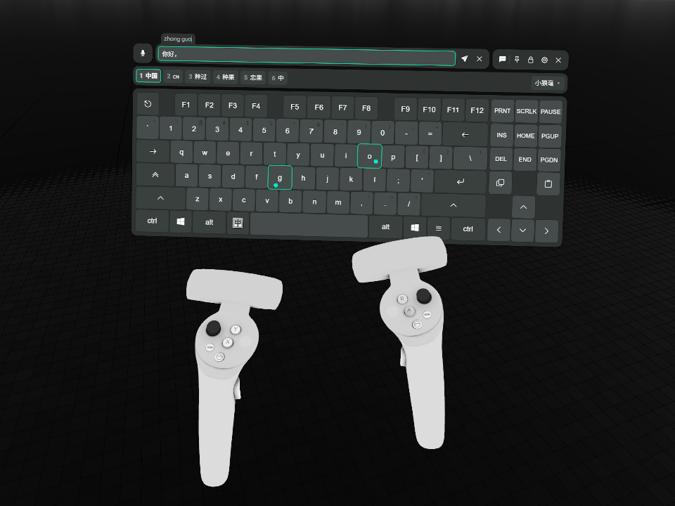
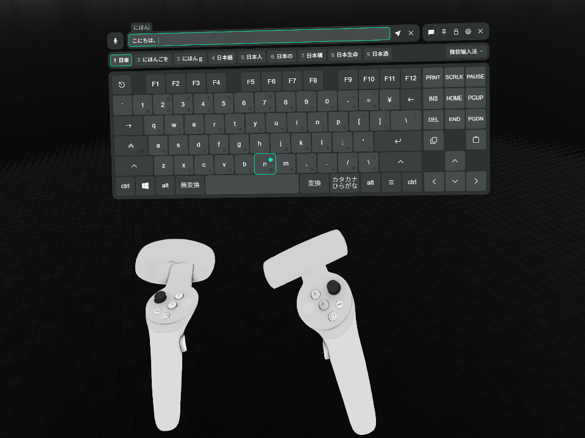

<!-- markdownlint-disable MD033 MD036 -->

# XSOverlay Keyboard IME

[简体中文](README.md) | **繁體中文** | [日本語](README.ja.md) | [한국어](README.ko.md) | [English](README.en.md)

> [!NOTE]
> 本文由 LLM 從簡體中文版轉換而成，可能有誤譯，或與原文語氣不同的表述。

給 XSOverlay 的 VR 鍵盤接入系統輸入法：在鍵盤頁的輸入框裡組字，組字串與候選顯示在鍵盤上，用鍵盤上的按鍵選候選，完成輸入後寫回輸入框。

以及 VRC ChatBox 功能增強：開啟它並聚焦輸入框後，正文每秒更新一次頭頂氣泡（不包括預編輯），清空或失焦保留氣泡，傳送成功後清空輸入框。正文超限時保留本機全文，氣泡顯示截短預覽並報錯。

## 聲明

本專案由一位不熟悉 C# 生態的開發者全程使用 AI 打造。程式實作可能有些粗糙，對重視整潔的開發者可能非常不友善，在此說聲抱歉。如果你有整理這類問題的想法，也歡迎提出方案或 PR，感謝。

## 為什麼做這個插件

VRChat 裡的中文輸入，試過的兩個方案都不夠用。

- [OVR Input Method Bridge](https://store.steampowered.com/app/3448100/OVR_Input_Method_Bridge/)：只支援微軟拼音和搜狗輸入法，兩個我都不常用，介面也太不順手，所以只算勉強湊合能用。
- [Tapi](https://booth.pm/zh-cn/items/7047187)：雖然輸入體驗確實非常好，但是它內建一套以 Rime 為基礎的輸入方案，不與系統輸入法打通，依習慣養出來的詞庫要帶過去也不太方便。

另有 [OVR Toolkit](https://store.steampowered.com/app/1068820/OVR_Toolkit/)，內建虛擬鍵盤，但已知有效能問題，因此未納入考慮；它能否輸入中文、社群有無現成方案，我未實測。

正好我發現 XSOverlay 的鍵盤近期官方支援了 VRC ChatBox 功能。於是我有了這個想法：把它接上系統輸入法，養好的詞庫就能直接用。這個插件由此開始。

### 開發者註

在和 AI Agent 修最後幾個疑難 Bug 的時候，我才意識到，做出一個通用的系統輸入法整合方案，原來要考慮這麼多奇奇怪怪的事情——不管是專案初期就冒出來、需要向它妥協的問題，或是最後出現的一系列複雜邊界情況……沒辦法，為了通用性與實作複雜度，只能犧牲使用者體驗來換取它們了，具體可以看 README 下的設計取捨一節，以及本專案的 ADR（懶得看可以讓 AI 給你講）。

我不敢說本插件是最好的 VR 輸入法解決方案，我也有點開始懷疑，明明已經有很好用的東西了，我為什麼還要做這麼個不倫不類的東西。但既然做都做出來了，如果它看起來能解決你的痛點，你也能接受因這些妥協而帶來的不便，不妨裝上試試看。如果你對這個插件感興趣，我會非常感謝你，那是對我莫大的支持和鼓勵。

## 展示

<table>
  <tr>
    <td width="50%"></td>
    <td width="50%"></td>
  </tr>
  <tr>
    <td align="center">小狼毫</td>
    <td align="center">微軟日文輸入法</td>
  </tr>
</table>

## 執行需求

### 系統 / 軟體版本

- Windows 10 或以上版本，64 位元。
- XSOverlay Beta 695，其他版本未經驗證。
- BepInEx 5.4.23.6，x64 版本，其他版本未經驗證。（快速安裝的壓縮檔已包含它）
- 本插件對鍵盤頁做了一些侵入性修改，與其他插件的相容性尚未驗證。

### 輸入法

- 只支援實作了 TSF 的輸入法。本專案以小狼毫（Rime Windows 版）、微軟拼音與微軟日文輸入法驗證。大部分輸入法理應都支援這個協定，如果不確定，可以裝上插件親自試試。
- 輸入法可能需要開啟行內預編輯，否則只看得到候選，看不到正在輸入的編碼。
  - 實測小狼毫必需，須在 `weasel.custom.yaml` 中設定 `style/inline_preedit: true`。

## 安裝

### A. 快速安裝（連同插件載入器一起安裝）

1. 從 [最新 Release](https://github.com/lgc2333/XSOverlay-Keyboard-IME/releases/latest) 下載 `XSOverlayKeyboardIme-<版本>+BepInEx.zip`。
2. 結束 XSOverlay。
3. 在 Steam 媒體庫中右鍵 XSOverlay，選擇「管理」→「瀏覽本機檔案」。
4. 把壓縮檔裡的全部檔案解壓縮進這個資料夾，詢問是否覆寫時選擇覆寫。
5. 啟動 XSOverlay 即可開始使用。

這個壓縮檔裡是插件加 BepInEx 5.4.23.6 x64。之前裝過 BepInEx 的話，第 4 步會覆蓋它的同名檔案，`BepInEx.cfg` 與各插件的設定不受影響。

### B. 手動安裝（如果你安裝過 BepInEx）

1. 從 [BepInEx Releases](https://github.com/BepInEx/BepInEx/releases) 下載 BepInEx 5.4.23.6 x64，解壓縮進 XSOverlay 資料夾。
2. 從 [最新 Release](https://github.com/lgc2333/XSOverlay-Keyboard-IME/releases/latest) 下載 `XSOverlayKeyboardIme-<版本>.zip`。
3. 把它解壓縮進 XSOverlay 資料夾，或解壓縮後把 `BepInEx\plugins\XSOverlayKeyboardIme\` 整個複製過去。
4. 啟動 XSOverlay 即可開始使用。

### 裝好之後

插件檔案在 `BepInEx\plugins\XSOverlayKeyboardIme\`。日誌在 `BepInEx\LogOutput.log`，本插件寫入的行以 `[ime]` 開頭。

要解除安裝，刪除 `BepInEx\plugins\XSOverlayKeyboardIme\` 資料夾。BepInEx 自己的檔案（`BepInEx\` 資料夾、`winhttp.dll`、`doorstop_config.ini`、`.doorstop_version`）只有在沒有其他插件使用它們時才刪除。

## 設計取捨

<!-- 依使用者的意外程度由高到低排序 -->

本節的行為看起來像故障，其實是有意為之。

### VRC ChatBox 按鈕點不亮

如果你在 VRChat 啟動之前啟動了 XSOverlay，而且可能也開著 TUN 模式的代理，那這是 XSOverlay 自身的缺陷。本插件沒有修復它，而且解決方法很簡單：在 VRChat 啟動之後再啟動 XSOverlay 就能解決，關閉後再重新啟動 XSOverlay 也行。

其他情況就不太清楚了。只是覺得可能會有和我遇到一樣問題的朋友，為了避免他們一直困惑，索性就寫在這裡了。

### 候選為什麼點不了

候選列只能看，點它不會有反應，也沒有翻頁按鈕和頁碼。

#### 為什麼這麼設計

本插件不依輸入法名稱做個別適配。這個取捨的弊端就體現在此。

點選候選要插件替你按鍵，但同一串鍵在不同輸入法裡的行為並不一樣：可能換候選，可能翻頁，也可能毫無反應。所以按鍵交回給你，輸入法怎麼解釋就怎麼執行。

頁碼同理，輸入法回報的頁碼不可靠，寧可不顯示也不顯示錯的。

#### 替代方案

選候選、翻頁都請按鍵盤，實體鍵盤和鍵盤頁上的按鍵都可以，照你平常在實體鍵盤上用輸入法的習慣操作。插件只負責把按鍵轉交給輸入法，按鍵是什麼意思由輸入法自己決定。鍵位以你自己的輸入法設定為準；鍵盤頁上沒有的鍵按不了，請挑鍵盤上有的鍵用。

以我正在使用的 rime-frost（白霜拼音）方案的預設鍵位為例：

- 數字鍵、空格：選候選；`-`、`=`：翻頁
- `↑`、`↓`：換候選；`←`、`→`：移動組字串裡的游標；`[`、`]`：以詞定字；等等……

### 按鍵結果誠實遵守輸入法和系統回應，和實體鍵盤盡量一致

插件把普通按鍵交給系統以及輸入法，結果由它們決定。

組字中換輸入法，丟棄編碼或提交原始碼都由輸入法決定，插件不補按鍵。名字與圖示隨通知或後續按鍵更新，可能到下一次按鍵才更新。

Shift、Ctrl、Alt 的按下與放開即時送到系統，黏滯、保持和解除規則跟隨 XSOverlay。關閉鍵盤時放開這些鍵，Caps 鎖定狀態不變。

鍵盤頁的 Win 只用於 Win+空格，單按不會開啟開始功能表，其他 Win 組合鍵不會執行，避免 VR 打字時誤開桌面視窗。

代價是輸入法自己的毛病也會原樣落到鍵盤上。以小狼毫為例：組字中按中英切換鍵（相當於點擊系統語言列圖示來切換中英，非使用 Shift），小狼毫會不結束組字，但候選消失，切回中文模式又能繼續組字。但微軟拼音切換後就會原樣上屏原始碼。這個行為非常令人困惑，但那是它自己的事，插件不替它收尾。

### 輸入法與輸入模式切換

候選列右側顯示輸入法名字和下拉框，中英切換鍵位於左 Alt 右側，顯示時空格縮短，隱藏時恢復，鍵盤列寬不變。

VR 鍵盤使用系統輸入法，下拉框列出所有語言中已啟用的輸入法和一般鍵盤配置，選取即可切換，也可使用 Win+空格。Windows 的共用輸入設定可能讓桌面視窗的輸入法一起變化。無法讀取目前輸入法時顯示較暗的「未知输入法」，清除舊圖示和選取標記，清單可用時仍可下拉選擇。

輸入模式切換按鈕會模擬點擊一次輸入法的語言列附加圖示。最終行為由各輸入法決定，因此可能出現一些奇怪的問題，例如小狼毫切換後不會結束組字，實測使用實體鍵盤也有同樣的問題，所以不在本插件的處理範圍內。

微軟拼音和日文微軟輸入法顯示原始模式字形，點擊按鈕即可切換輸入模式，也可以直接在鍵盤上使用輸入法對應的切換快捷鍵（例如快速點按 Shift 三次：前兩次啟用按住狀態，第三次放開，模擬實體鍵盤上一次 Shift 的按下與放開）。部分舊版系統可能有相容性問題，歷史相容性測試見[歸檔記錄](docs/archived/notes/input-mode-shell.md#支持范围)。

### 為什麼輸入法名字和中英切換鍵在輸入框非焦點狀態下隱藏

輸入框失去焦點後，輸入法資訊就沒有穩定的來源。插件拿不到一個能一直作準的值，顯示出來隨時可能對不上實際，所以乾脆隱藏。

名字說的是「此刻按下的鍵會送進哪個輸入法」，有焦點時才顯示。中英切換鍵依語言列附加圖示的有無顯示，無法讀取原圖時使用固定佔位，美式配置隱藏。

### 為什麼只在鍵盤頁的輸入框裡生效

組字要搶前景、替你按鍵，範圍一放寬就會管到別的視窗，風險比收益大。所以插件只接管鍵盤頁內建輸入框裡的按鍵，XSOverlay 裡的其他輸入框、桌面、別的應用程式都不接管，以後也不打算支援。

### 為什麼組字時會短暫搶走前景

組字要把按鍵送進輸入法，只有一條路：模擬全域按鍵。而模擬按鍵只會送到前景視窗。

送鍵前，插件嘗試把自己的隱藏視窗提到前景，結束後歸還前景。切換失敗時，本次按鍵不會送出，插件會記錄失敗，不會重試。

### 為什麼候選列空著也在

候選列不顯示候選時也不消失。鍵盤視窗的高度因此不變，打字時鍵盤不會上下跳。

組字會在每次按鍵後開始或結束。候選列如果隨內容出現和消失，鍵盤就會反覆改變高度，VR 裡很難受。

### 為什麼組字時傳送鍵是灰的

組字串暫時放在輸入框裡，鍵盤頁見輸入框非空就會讓傳送鍵變成可點，不打一聲招呼就能把拼音發出去。所以插件在組字期間把它壓回停用。完成輸入或取消後恢復正常。

## 建置

需要 .NET SDK 10 或更高版本、CMake，以及 Visual Studio 的 C++ 建置工具。

先取得上游原始碼，再編譯原生函式庫：

```powershell
git submodule update --init
pwsh native/build.ps1
```

然後編譯插件：

```powershell
dotnet build -c Release
```

把插件與原生函式庫一起安裝進 XSOverlay：

```powershell
dotnet build -c Release -p:DeployToGame=true
```

專案設定的 XSOverlay 路徑為 `D:\SteamLibrary\steamapps\common\XSOverlay_Beta`。XSOverlay 不在該路徑時，用 `GameDir` 屬性指定：

```powershell
dotnet build -c Release -p:DeployToGame=true -p:GameDir="D:\Steam\steamapps\common\XSOverlay_Beta"
```

產出發布壓縮檔：

```powershell
pwsh scripts/pack.ps1
```

它在 `dist/` 寫出 `XSOverlayKeyboardIme-<版本>.zip`（只有插件）與 `XSOverlayKeyboardIme-<版本>+BepInEx.zip`（插件加 BepInEx）。腳本用 csproj 裡的 `GameDir`，要換路徑就傳 `-GameDir`。

## 致謝

- [Windmill-City/IngameIME-Common](https://github.com/Windmill-City/IngameIME-Common)，[Windmill-City/IngameIME_Win32](https://github.com/Windmill-City/IngameIME_Win32)：TSF 輸入上下文與組字回呼。此相依性與本專案的 C 薄殼一起編進 `IngameIME.dll`，整份依 LGPL 2.1 散布，見 [THIRD-PARTY-NOTICES.md](THIRD-PARTY-NOTICES.md)。
- DeepSeek V4.1 Flash & DeepSeek Harness，GPT 6.1 Sol & Codex：本專案全程由大肥魚媽媽與小龍娘建構。

## 贊助

**[贊助我](https://lgck.cc/sponsor)**

感謝大家的贊助！你們的贊助是我繼續創作的動力！

## 聯絡

- QQ：3076823485
- QQ 群：[168603371](https://qm.qq.com/q/EikuZ5sP4G)
- Telegram：[@lgc2333](https://t.me/lgc2333)
- 電子郵件：<lgc2333@126.com>

## 許可

插件程式碼依 MIT 許可證散布，全文見 [LICENSE](LICENSE)。

插件隨套件散布 `IngameIME.dll`。它包含 IngameIME 與 `native/shim/` 的 C 薄殼，整份依 GNU LGPL 2.1 散布，全文見 [native/LICENSE-LGPL-2.1.txt](native/LICENSE-LGPL-2.1.txt)。`IngameIME.dll` 是插件旁邊的獨立檔案，可以自行重新編譯並替換，做法見 [THIRD-PARTY-NOTICES.md](THIRD-PARTY-NOTICES.md)。

---

_Made with ♥️ by LgCuwukii_
