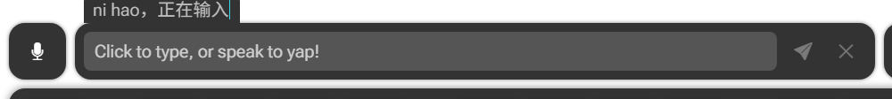
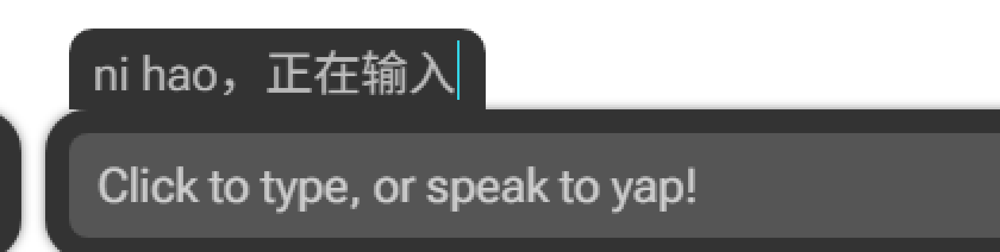

# 2026-11-10 路线图缺陷调查

本次调查覆盖[路线图](../../ROADMAP.md)的五项报告，调查时产品代码未修改，五项均未标记修复，后续状态以路线图为准。

运行环境为 Windows、SteamVR 与 XSOverlay Beta。安装版和本地产品 DLL 的 SHA256 均为 `E3C9CEFDFC69EBE329E6922929167ECAA1248694804B18EFD51FD4E9B026FE10`，产品程序集 MVID 为 `065b31a6-7cb3-4fc1-948d-3dec8126908a`。

运行时实验使用临时诊断插件、原生 Vuplex 指针事件及独立 Shell 图像观察器。没有输入正文、发送 OSC 或读写输入法中英模式。实验结束后已恢复小狼毫、关闭键盘、移除本次诊断插件，并经 Steam 重启 XSOverlay。

## 结论与边界

| 报告                   | 来源与证据                                                                                         | 尚未确认                                          |
| ---------------------- | -------------------------------------------------------------------------------------------------- | ------------------------------------------------- |
| 首开输入法下拉框隐藏   | 真机收到可信点击和资格请求，但前台获取失败；插件回退的空闲检查返回 false，随后采到 `0xF2` 高位状态 | `0xF2` 的来源，以及原用户点击桌面浮窗后的完整顺序 |
| 预编辑栏裁切与连接缺口 | 真实安装素材复现，插件标签位于视口外，并接在原生圆角上                                             | 最终画布尺寸、缩放和 VR 观感                      |
| 微软拼音切换禁用       | 真机进入 Shell 分支，产品主动调用 `Disabled()`；生产路径未接入 UIA 点击                            | 接入现有协调器后的真实点击验收                    |
| 迟到图标不更新         | 真机对照中，产品释放订阅后，独立观察器收到新图标，页面仍显示旧图标                                 | 独立观察器会影响订阅条件，不能还原原用户那次时序  |
| 发送后 typing 再现     | 真实页面模块与当前广播类离线复现成功清空至实际失焦之间的竞态                                       | 实际 VRChat 是否命中、出现频率和约一秒的持续时间  |

## 首开：请求已到达，前台资格未获得

[页面显示](../../../web/src/candidate-bar.ts)按 `view.active` 隐藏输入法名称；枚举结果为空只会禁用列表。自动 focus 和状态回报不授予资格，规则见 [0060](../../adr/0060-create-refocus-requests-when-page-input-arrives.md)。

从关闭状态打开键盘后，原生 Vuplex `PointerDown` / `PointerUp` 产生可信页面事件。产品收到 `AcquireFocus`，但没有获得前台。下表的毫秒值来自同一次诊断进程的单调时钟。

| 时间（ms） | 事件                                                             |
| ---------: | ---------------------------------------------------------------- |
|  66873.717 | `ImeHost.AcquireFocus` 开始                                      |
|  66885.696 | 普通 `SetForegroundWindow` 已返回 false；原前台身份仍未改变      |
|  66896.068 | `KeysAndMenusIdle=false`；紧随其后的键状态采样仅列出十进制 `242` |
|  66901.872 | 获取失败后结束资格，页面保持 inactive                            |
| 229135.991 | 同一进程的第二次点击仍返回空闲检查失败，采样仍为 `242`           |

[空闲检查](../../../XSOverlayKeyboardIme/Ime/ForegroundLease.cs)遍历虚拟键码 `1..255`，任意 `GetAsyncKeyState(key) & 0x8000` 非零就拒绝回退。[前台算法](../../../XSOverlayKeyboardIme/Takeover/ForegroundAcquisition.cs)因此没有执行 Alt pair。Windows SDK 将 `0xF2` 命名为 `VK_OEM_COPY`；本次没有证据把该状态解释为物理键一直按住。

另一次干净启动中，独立实验窗口通过公共 `AllowSetForegroundWindow` 只授权当次 XSOverlay PID。随后的相同原生点击使普通前台获取成功，输入法名称出现。该对照说明前台资格足以改变结果，但没有复现用户点击桌面浮窗的完整动作。

修复前应追踪 `0xF2` 的产生者，并确认空闲检查应覆盖的键集合。现有证据不足以决定忽略该键、扩大前台权限或增加重试。

## 预编辑栏：预留高度和圆角不匹配

隔离 Chromium 使用安装版键盘骨架、composer、布局、样式与字体，加载当前[预编辑模块](../../../web/src/preedit-display.ts)及[样式](../../../web/src/preedit-display.css)。宿主回调为空操作，页面无加载错误。该布局根节点约为 `1197×597` CSS 像素；真机页另测为 `1432×671`，两者不作等同。

| 几何量         |   实测值 | 结果                                        |
| -------------- | -------: | ------------------------------------------- |
| 根节点顶部     |    `0px` | 页面边界不提供额外空间                      |
| composer 顶部  |   `26px` | 标签高 `34px`，顶部落到 `-8px`              |
| 标签文字行顶部 | `-5.5px` | 安装版 `html/body overflow:hidden` 裁到文字 |
| composer 圆角  |   `18px` | 原生骨架按布局间距 `10+8` 设置              |
| 标签左缩进     |   `10px` | 接在圆弧上，缺口宽 `8px`、最深约 `1.875px`  |

当前真实素材截图：

为显示完整连接处，诊断页仅把根节点下移，再放大四倍：

临时对照把顶部预留改为 `34px`、左缩进改为原生圆角 `18px`，两种现象均消失。这只用于验证原因；总高随之增加 `8px`，长标签的右侧余量也需同步核对。

[现有测试](../../../web/tests/composer.spec.mjs)使用 mock 工具栏样式和测试页边距，没有真实骨架与圆角，因此未覆盖此问题。修复前应确认画布尺寸往返及左右余量；[0056](../../adr/0056-show-preedit-in-a-composer-tab.md)的固定几何值需要重新核对，本记录不修改其决定。

## 微软拼音：禁用和丢图标属于同一条旧链路

调查时[宿主](../../../XSOverlayKeyboardIme/Ime/ImeHost.cs)仍实例化 `InputModeButton`，旧源码可用 `git show 06c7890:XSOverlayKeyboardIme/Ime/InputModeButton.cs` 查看。该类只实现公共语言栏点击，Shell 读数被 `view?.Disabled()` 强制禁用。当时已有的 [InputModeSwitch](../../../XSOverlayKeyboardIme/Ime/InputModeSwitch.cs) 与 UIA 平台尚未进入生产构造链；与 [0051](../../adr/0051-use-taskbar-uia-for-shell-mode-clicks.md)记载一致。

真机从小狼毫切到微软拼音后，产品记录 `publicItem=false, shell=true, enabled=false`，页面为 `aria-disabled=true`，提示为“英语模式”。因此禁用来自插件限制，不能归为 UIA 点击失败。

随后进行保持宿主前台的观察对照。独立观察器只读 Shell 图像，不向产品发布，也不点击模式按钮。下表使用第二次诊断进程的同一单调时钟。

| 时间（ms） | 事件                                                            |
| ---------: | --------------------------------------------------------------- |
| 124781.969 | 独立观察器首次读到图标 `U+E983`                                 |
| 124789.442 | 产品最后一次读取仍为 `U+E983`                                   |
| 124789.507 | 产品释放 Shell 订阅                                             |
| 124791.390 | 产品最后一个完成消息处理结束，Shell 订阅已不存在                |
| 124793.196 | 独立观察器收到新图标 `U+E982`，页面仍保留旧图标和“英语模式”提示 |

新图标比产品释放订阅晚约 `3.69ms`，说明一次读取加立即释放不能覆盖该异步更新。此处记录的是图标变化，没有读取中英模式。独立观察器在产品完成消息之间打开，会改变订阅条件；此对照证明当前链路会漏掉迟到图像，不证明原用户那次切换的精确顺序。

后续工作需核对已存在的协调器与 [0050](../../adr/0050-hold-the-host-focus-for-the-composer.md)、0051 的前台和订阅寿命要求，再验证生产接线、失焦取消和真实 UIA 点击。现有旧探针的模拟测试不能替代生产路径验收。

## ChatBox：成功清空与实际失焦之间可以重新开启 typing

[CompleteSubmission](../../../XSOverlayKeyboardIme/Game/ChatboxIntegration.cs)在原生发送完成后调用 `EndSubmission()`，并请求新 revision 状态。安装版成功处理随后清空正文、取消 pending、请求释放焦点；正常焦点释放经 WebSocket 通知后才实际 `blur()`。

隔离浏览器直接运行安装版 composer/view 和当前[页面观察器](../../../web/src/chatbox.ts)，再把真实页面快照送入当前 [ChatboxBroadcast](../../../XSOverlayKeyboardIme/Chatbox/ChatboxBroadcast.cs)。发送委托仅记录内存消息，没有创建 OSC 传输。复现顺序如下，序号不是实际毫秒。

| 事件序号 | 状态或结果                                                        |
| -------: | ----------------------------------------------------------------- |
|       12 | 正式发送开始，revision 增至 `1`                                   |
|       16 | 广播输出 `typing=false`                                           |
|       18 | 原生发送完成，解除发送门禁                                        |
|       24 | 页面成功处理请求释放焦点                                          |
|       25 | 实际页面上报 `revision=1, active=true, text="", submitting=false` |
|       29 | 当前广播类输出 `typing=true`                                      |
|       31 | 延后的焦点释放通知使输入框失焦                                    |
|       36 | 广播输出 `typing=false`                                           |

七个场景通过预期断言：refresh 在成功前或成功后且释放延后，都得到 `true,false,true,false`；先失焦、仅旧 revision、同步失焦对照均不产生额外开启；失败恢复和新编辑仍正常开启 typing。

广播先按 `active && !submitting` 更新 typing，再检查正文是否为空，因此新 revision 的空正文仍能重新开启 typing。旧 revision 防护有效；`1000ms` 仅限制正文发送，不解释报告中的约一秒显示。

[页面回归](../../../web/tests/native-chatbox.spec.ts)把释放 API mock 为同步 `blur()`，遗漏了该窗口。后续需覆盖真实异步释放并保留失败恢复、新编辑行为；若要归因到报告中的 VRChat 显示，还需对齐真实页面状态与被动 UDP 时间线。

## 后续边界

本记录提供来源分类、复现和剩余问题，不选择新的产品行为。涉及前台策略、预编辑画布尺寸或发送完成协议的改变，应按项目规则先讨论是否需要 ADR。现有 ADR、产品代码和测试均未在本次调查中修改。
